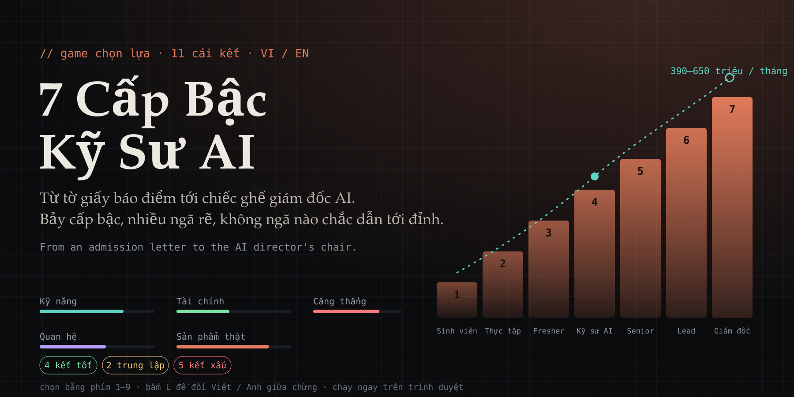
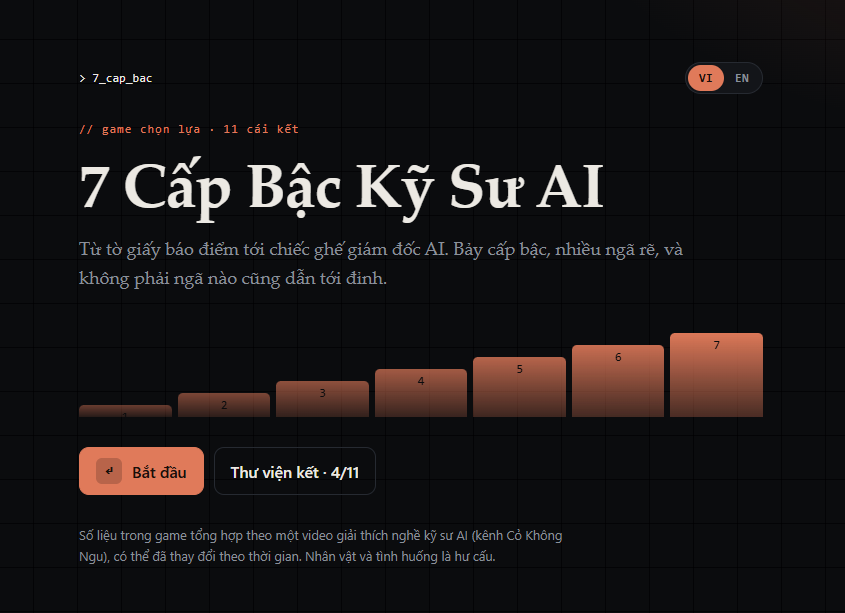
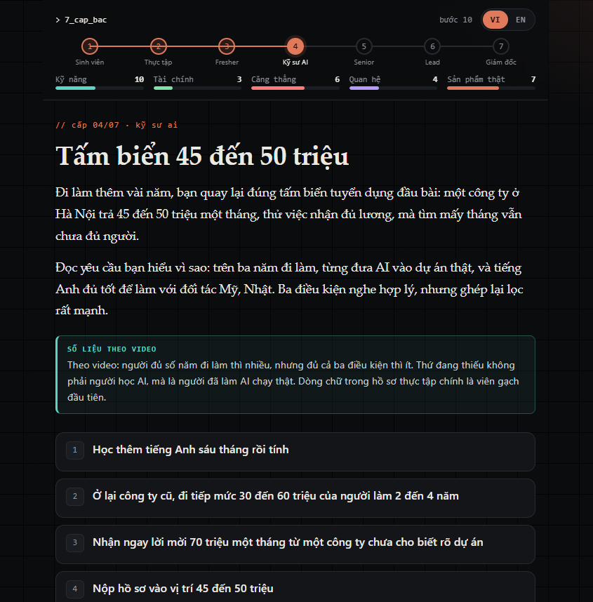
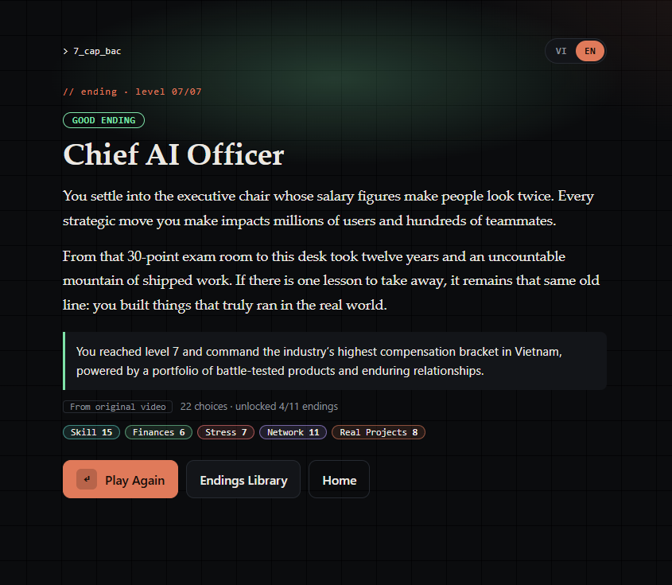

# 7 Cấp Bậc Kỹ Sư AI

*Một tờ giấy báo điểm. Bảy cấp bậc. Một chiếc ghế giám đốc AI ở cuối đường.*

Bạn có đi tới đó không? Tùy bạn học gì, nhận việc nào, nghỉ lúc nào, và tin vào lời hứa nào. Mỗi lựa chọn đều có giá của nó.

## [▶ Chơi ngay trên trình duyệt](https://gaorb80.github.io/ai-engineer-career-game/)

Không cần cài, không cần đăng nhập, chơi được cả trên điện thoại.

  
  
  

## Có gì trong đó

- **Bảy cấp bậc,** từ sinh viên tới giám đốc AI, với mức lương, học phí, luật AI lấy từ chuyện thật.
- **Mười một cái kết.** Có người lên đỉnh, có người lập công ty, có người ra nước ngoài, có người kiệt sức giữa đường.
- **Những cái bẫy nghe rất hợp lý:** mức lương 70 triệu không nói rõ dự án, khoản vay mua nhà quá sớm.
- **Căng thẳng chạm 10 là hết.** Muốn đi xa phải biết lúc nào nên nghỉ.
- **Việt hoặc Anh,** đổi bất cứ lúc nào bằng nút **VI / EN** hoặc phím `L`, tiến trình vẫn giữ nguyên.

Bạn sẽ ra sao ở cuối đường? Mở lên chơi thử.

## Lấy cảm hứng từ

Video [7 Cấp Bậc Thăng Tiến Kỹ Sư AI](https://www.youtube.com/watch?v=9mbIKLKq9UM) của kênh Cỏ Không Ngu. Các con số về lương, học phí, điểm chuẩn, luật AI là từ video đó; nhân vật, lựa chọn rẽ nhánh và chín trong mười một kết là phần viết thêm.

## Tìm hiểu thêm

- [Về dự án: bảy cấp, nguồn, ai làm ra](docs/ABOUT.md)
- [Phát triển: chạy trên máy, test, thêm nội dung hoặc ngôn ngữ](docs/DEVELOPMENT.md)
- [Cấu trúc file truyện](docs/STORY_SCHEMA.md) · [Thiết kế cốt truyện](story/STORY.md)

---

## English

**7 Levels of an AI Engineer** is a branching choose-your-path game. You start with an exam score report and climb seven levels, from student to AI director. Every choice costs something, and eleven endings wait at the bottom: four good, two neutral, five bad.

**[▶ Play now in your browser](https://gaorb80.github.io/ai-engineer-career-game/)** — nothing to install, works on phones, switch English/Vietnamese anytime with the **VI / EN** button or `L`.

Inspired by the Vietnamese video [7 Cấp Bậc Thăng Tiến Kỹ Sư AI](https://www.youtube.com/watch?v=9mbIKLKq9UM) ("The 7 Levels of AI Engineer Career Progression", channel Cỏ Không Ngu). Salary, tuition and law figures come from it; the branching choices and nine of the eleven endings are original. Running locally and contributing: [docs/DEVELOPMENT.md](docs/DEVELOPMENT.md).
